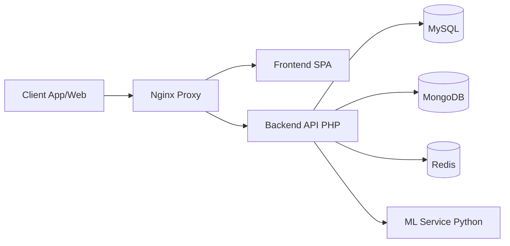

# FraudLens

FraudLens is an enterprise-grade fraud detection and management platform. It uses machine learning to score transactions in real-time and provides a comprehensive dashboard and mobile app for human review.

## Architecture

## Tech Stack
| Component | Technology |
|---|---|
| Frontend | Vue/React/Svelte + TypeScript |
| Backend | PHP 8.3 + Laravel |
| ML Pipeline | Python 3.11 + PyTorch/XGBoost |
| Mobile | Flutter |
| Database | MySQL + MongoDB |
| Cache/Queue | Redis |

## Prerequisites
- Docker and Docker Compose
- Node.js 20+ (for local frontend dev)
- Python 3.11 (for local ML dev)
- PHP 8.3 (for local backend dev)
- Flutter SDK (for mobile dev)

## Quick Start
1. Clone the repository
2. `cp docker/.env.example .env`
3. `docker compose up -d --build`

## Development
See individual READMEs in each service directory.

## Contributing
Please read CONTRIBUTING.md for details on our code of conduct, and the process for submitting pull requests to us.

## License
This project is licensed under the MIT License - see the LICENSE file for details.
